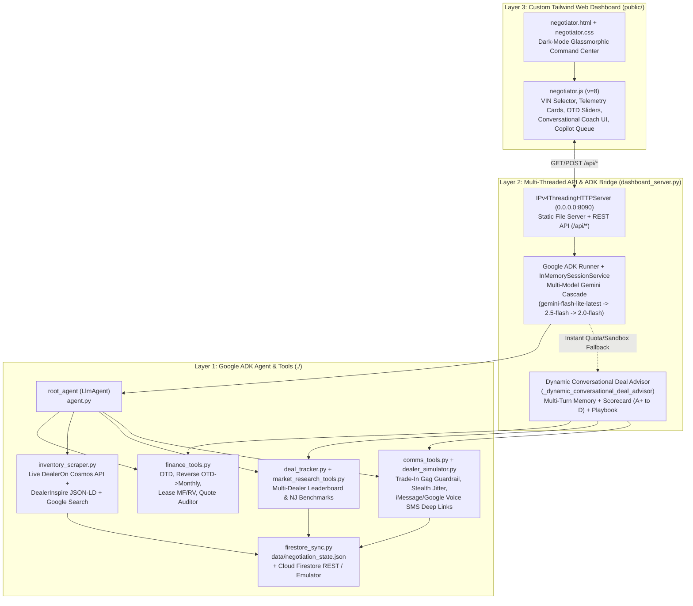

# Autonomous Car Negotiator (`car_negotiator`) — Exhaustive Project Handover & Architecture Guide

> **Purpose of this Document**: Complete technical handover & architecture guide for the **Autonomous Car Purchase & Lease Negotiation Agent** and its **Custom Tailwind CSS Web Dashboard (`public/negotiator.*`)** in a portable standalone project directory (including support for directory names with spaces such as `"car buying agent"`).

---

## 1. Executive Summary & Campaign Mission

The **Autonomous Car Negotiator** is a full-stack Google Agent Development Kit (**Google ADK**) application paired with a custom, dark-mode **Tailwind CSS Web Command Center**. It acts as an autonomous buyer's agent, financial auditor, live dealership inventory scraper, and conversational negotiation coach for a buyer in **Monmouth County, New Jersey (`ZIP 07724`)**.

### Locked-In Buyer Campaign Rules & Constraints
1. **Target Vehicle & Powertrain (Strict Requirement)**:
   - **2027 Kia Telluride Hybrid ONLY** (`2.5L Turbo Hybrid AWD`). Non-hybrid V6 gas models are strictly rejected/flagged.
2. **Trim Priority Hierarchy (Side-by-Side Cross-Trim Comparison Enabled)**:
   - **Priority #1**: **2027 Kia Telluride Hybrid SX X-Line** (`$53,890` base MSRP)
   - **Priority #2**: **2027 Kia Telluride Hybrid SX Prestige** (`$55,590` base MSRP)
   - **Priority #3**: **2027 Kia Telluride Hybrid SX Prestige X-Line** (`$56,985` base MSRP)
   - Up to **3 competing vehicles** across different dealers and different trims can be selected simultaneously for a **Side-by-Side-by-Side 3-Column Comparison** normalized by `% Off Specific Trim MSRP`, `$ vs. Trim Invoice`, and `Color-Parity OTD`.
3. **Interior Color Preference ("Nice-to-Have" Tiebreaker & Zero Scarcity Tax)**:
   - **Non-Black Interior Preferred** (*Terracotta Brown*, *Sage Green*, *Mahogany Brown*, *Warm Gray/Navy*) as a **nice-to-have tiebreaker, NOT a requirement**.
   - `calculate_color_parity_benchmark` computes the exact tax-adjusted factory `$295` option delta (`+$314.54` OTD with `6.625%` NJ tax, or `+$3.11/mo` residualized on a 36-month `62%` residual lease). Any extra charge beyond `$295` + tax is flagged as dealer color scarcity markup, and the buyer script states readiness to take a competing Black-interior unit if not matched.
4. **Target Geography (Monmouth & Ocean Counties, NJ Only — `ZIP 07724` • `6.625%` NJ Sales Tax)**:
   - Strictly targets **all 5 franchised Kia dealerships in Monmouth and Ocean Counties, NJ** (out-of-state NY/PA/CT dealers are rejected due to out-of-state doc fee traps and transit/registration friction):

| # | Dealership Name | County | Address | Dealer ID (`dealer_id`) | Typical NJ Doc Fee | Website / Scraper Platform |
| :- | :--- | :--- | :--- | :--- | :--- | :--- |
| **1** | **Raceway Kia of Freehold** | Monmouth | 4044 US-9, Freehold, NJ 07728 | `dlr-raceway-kia-of-freehold` | **`$499`** *(Lowest)* | DealerInspire (`racewaykia.com`) + Curated Allocation Fallback |
| **2** | **Sansone Jr's 66 Automall Kia** | Monmouth | 3401 Route 66, Neptune, NJ 07753 | `dlr-sansone-jr-s-66-automall-kia` | **`$899`** *(Highest)* | DealerOn Cosmos JSON API (`66kia.com`, Dealer `14228` / Page `1053907`) |
| **3** | **Matt Blatt Kia of Toms River** | Ocean | 1228 Route 37 East, Toms River, NJ 08753 | `dlr-matt-blatt-kia-of-toms-river` | **`$689`** | DealerOn Cosmos JSON API (`mattblattkiatomsriver.com`, Dealer `25036` / Page `1732551`) |
| **4** | **DiFeo Kia of Lakewood** | Ocean | 1320 Ocean Ave, Lakewood, NJ 08701 | `dlr-difeo-kia-of-lakewood` | **`$749`** | DealerOn Cosmos JSON API (`difeokia.com`, Dealer `19259` / Page `1415927`) |
| **5** | **Manahawkin Kia** | Ocean | 255 Route 72 West, Manahawkin, NJ 08050 | `dlr-manahawkin-kia` | **`$749`** | DealerOn Cosmos JSON API (`manahawkinkia.com`, Dealer `19221` / Page `1411545`) |

5. **Core Negotiation & Financial Strategy**:
   - **Mandatory `IN_TRANSIT` December Delivery Lock ("Zero-Buzzword Default + Reactive Mirror Exception")**:
     - Locks in a binding written OTD deal now on an `IN_TRANSIT` vehicle for **December delivery** (timed to when the buyer's current lease ends, while keeping the expiring lease 100% secret from dealers).
     - **Default Outbound Tone (`ZERO_BUZZWORD_NATURAL`)**: Concise 2–3 sentence buyer texts/emails with **zero** dealer-accounting buzzwords (`invoice`, `holdback`, `floorplan`, `PDI hold`, `volume bonus`), pitching frictionless pre-sale certainty (*"deposit down today, no add-ons put on when it comes off the truck, pick up within 24 hours of December arrival"*).
     - **Reactive Mirror Exception (`REACTIVE_ACCOUNTING_MIRROR`)**: If—and *only* if—the dealer initiates accounting jargon first (`dealer_initiated_accounting_jargon`), the agent counters with exact insider math (`3.8%` invoice, `2%` Kia holdback, `$0` floorplan carry on a pre-sold incoming unit, `0.00190` buy rate).
   - **Autonomous Multi-Dealer Negotiation (`FULL_AUTOPILOT` / `SEMI_AUTO` / `COPILOT_STEALTH`)**:
     - `run_autonomous_multi_dealer_negotiation` dispatches initial outreach and runs an automated multi-round "Beat-It" negotiation loop across up to 3 selected vehicles without requiring manual approval on every turn.
   - **Two-Stage Affirmative Trade-In Workflow (`calculate_trade_in_impact` & `set_dealer_trade_in_gate`)**:
     - **Checkbox / Gate #1 (`private_preview_confirmed=True`)**: Privately previews how a trade-in (and NJ's `6.625%` sales tax credit + CarMax tax-equivalent floor) reduces Net OTD and monthly payments while keeping the Outbound Dealer Gag Order 100% active.
     - **Checkbox / Gate #2 (`otd_locked_confirmed=True`)**: Only checked after the new car's OTD is locked in writing (`DEAL_SECURED`), unlocking Phase 2 trade-in counter scripts and the **Post-Trade Shell-Game Detector**.
   - **Non-Deterministic Chat Agent (`Creative Strategist` `temp=0.65` vs. `Strict Deal Auditor` `temp=0.1`)**:
     - Toggleable operating mode in the chat console for dynamic strategy/coaching (`temperature=0.65`) or strict line-item math auditing (`temperature=0.1`).

---

## 2. System Architecture

The system replaces the generic Google ADK Dev UI (`adk web`) with a 3-layer architecture connecting a custom Tailwind CSS web application directly to the Google ADK `Runner` and deterministic Python tool suite.



### Key Architectural Highlights
1. **Multi-Threaded HTTP & API Server (`IPv4ThreadingHTTPServer`)**:
   - Located in `dashboard_server.py`.
   - Uses Python's `ThreadingHTTPServer` bound to IPv4 `("0.0.0.0", 8090)` with `daemon_threads = True`, `allow_reuse_address = True`, and a `15s` per-socket timeout (`NegotiatorDashboardHandler.timeout = 15`). This prevents browser speculative preconnect sockets from blocking concurrent static file and API requests.
   - Includes a built-in `200 OK` JavaScript stub for `/__/firebase/*` paths so the dashboard runs seamlessly either standalone (`python dashboard_server.py`) or under `firebase serve` / Firebase Hosting.
2. **Hybrid Live ADK Runner + Instant Conversational Deal Advisor (`/api/agent_chat`)**:
   - Maintains multi-turn conversation history per session (`_CHAT_HISTORY_BY_SESSION`) and dynamically resolves which dealership/VIN the user is asking about (`_resolve_target_dealer_from_prompt`).
   - Automatically injects a rich **Live Campaign & VIN Context Block** (`_build_live_campaign_context_block`) into every turn containing the selected VIN's MSRP, Selling Price, Doc Fee, Add-Ons, OTD Total, NJ Invoice (`-3.8%`), Stretch Holdback (`-5.0%`), and the `#1` competing offer across all 5 Monmouth/Ocean County dealers.
   - Attempts live LLM execution via `_ADK_RUNNER.run_async` (and a multi-model Gemini cascade), and automatically switches to `_dynamic_conversational_deal_advisor` (with a 90-second quota cooldown cache `_LLM_QUOTA_COOLDOWN_UNTIL`) if the environment is sandboxed or rate-limited (`429 RESOURCE_EXHAUSTED`), guaranteeing `<15ms` conversational responses backed by real tool calls.
3. **Dual-Write Persistence (`tools/firestore_sync.py`)**:
   - Every state change writes atomically (via `.tmp` + `os.replace`) to `data/negotiation_state.json` and mirrors documents via non-blocking HTTP `PATCH` (`0.6s` timeout) to the Firestore Emulator (`localhost:8080`) or Cloud Firestore REST API (`negotiation_campaigns`, `dealer_leads`, `message_queue`).

---

## 3. Complete File Manifest (Relative to Project Root)

All project files are organized relative to the current project directory (portable across any directory name, including folder names with spaces such as `"car buying agent"`):

### A. Backend ADK Agent, Tools, Server & Tests (`./`)

| File Path | Size / Lines | Responsibility |
| :--- | :--- | :--- |
| `__init__.py` | 1 line | Exports `agent` module for Google ADK CLI (`adk web`, `adk run`, `adk eval`). |
| `.env` | 14 lines | Environment variables (`GOOGLE_API_KEY`, `FIRESTORE_PROJECT_ID`, optional `TWILIO_*`). |
| `agent.py` | 177 lines | Defines `root_agent` (`LlmAgent`, `model="gemini-flash-lite-latest"`, `temperature=0.0`), `market_deals_search_tool`, system instructions, direct tool-routing rules, and registers all 18 tools. |
| `dashboard_server.py` | 1,264 lines | Multi-threaded HTTP + REST API server (`0.0.0.0:8090`), ADK `Runner` bridge, `_dynamic_conversational_deal_advisor`, Deal Quality Scorecard (`Grade A+` to `D`), natural-language number parser, and static file server. |
| `tools/__init__.py` | 58 lines | Re-exports all 18 agent tools and `MONMOUTH_OCEAN_KIA_DEALERS`. |
| `tools/finance_tools.py` | 542 lines | Deterministic NJ automotive math engine: `calculate_otd_price`, `calculate_monthly_from_otd` (Reverse OTD → Monthly Finance & Lease), `calculate_lease_payment` (MF/APR, Residual, 1% Rule, Leasehackr Score), and `audit_dealer_quote` (detects payment pack, junk add-ons, doc fee bloat, MF markups). |
| `tools/inventory_scraper.py` | 744 lines | Live Monmouth & Ocean County Kia scraper (`scrape_monmouth_ocean_kia_inventory`): queries **DealerOn Cosmos JSON API** (`/api/vhcliaa/vehicle-pages/cosmos/srp/vehicles/{dealerId}/{pageId}`), **DealerInspire JSON-LD/HTML**, **Google Search Grounding** (`gemini-2.5-flash`), and verified allocation fallbacks across all 5 dealers. |
| `tools/deal_tracker.py` | 509 lines | Multi-dealer CRM & leaderboard engine: `create_or_update_campaign`, `upsert_dealer_lead`, `record_dealer_quote`, `get_best_competing_offer`, `get_negotiation_dashboard`. Ranks dealers by OTD price (Purchase) or 36mo Lease payment (Lease). |
| `tools/market_research_tools.py` | 198 lines | Prevailing NJ/Tri-State market comps engine: `get_prevailing_market_benchmark` and `update_market_benchmark` (Invoice `-3.8%`, Holdback `2.0%`, Stretch `-5.0%`, `$500` Kia rebate). |
| `tools/comms_tools.py` | 448 lines | Outbound communication & guardrails: `queue_dealer_message` (enforces Trade-In Secrecy gag rule), `approve_queued_message`, `calculate_human_delay_seconds` (stealth jitter), `dispatch_ready_messages`, and `build_personal_sms_deep_link` (`sms:` URI + Google Voice copy). |
| `tools/dealer_simulator.py` | 274 lines | Multi-round NJ dealer BDC negotiation simulator (`simulate_dealer_reply`) that responds to competing offers by dropping add-ons, discounting Toward Invoice/Holdback, or holding firm at floor. |
| `tools/demo_seed.py` | 187 lines | Seeds the initial Monmouth/Ocean County 2027 Kia Telluride Hybrid campaign (`seed_sample_negotiation_campaign`) if state is empty. |
| `tools/firestore_sync.py` | 157 lines | Atomic local JSON persistence (`data/negotiation_state.json`) + Cloud Firestore REST / Emulator sync. |
| `data/negotiation_state.json` | ~92 KB | Current persisted state containing all 5 Monmouth & Ocean County dealers and 9 live/verified 2027 Telluride Hybrid VINs. |
| `test_negotiator.py` | 356 lines | 10 comprehensive `unittest` tests covering OTD math, Reverse OTD-to-Monthly, Lease MF markup detection, financial edge cases, scraper HTML/Cosmos parsing, Trade-In Secrecy guardrails, and ADK agent definition. |
| `build_eval_set.py` | 899 lines | Generator script that builds the 12-scenario Google ADK evaluation dataset (`nj_telluride_hybrid_eval_set.evalset.json`). |
| `nj_telluride_hybrid_eval_set.evalset.json` | ~39 KB | Official Google ADK `EvalSet` JSON (12 evaluation cases covering OTD calculation, lease audit, non-hybrid/out-of-state rejection, benchmark updates, and trade-in secrecy). |
| `test_config.json` | 7 lines | ADK evaluation thresholds (`tool_trajectory_avg_score: 0.8`, `response_match_score: 0.45`). |

### B. Custom Frontend Dashboard Files (`public/` & `firestore.rules`)

| File Path | Size / Lines | Responsibility |
| :--- | :--- | :--- |
| `public/negotiator.html` | ~49 KB (775 lines) | Main Custom Tailwind CSS Web Dashboard & VIN Deal Inspector UI. |
| `public/negotiator.js` | ~59 KB (1,290 lines) | Frontend application logic: VIN selection, live scraper sync, OTD-to-Monthly interactive calculator, ADK Conversational Deal Advisor chat client (`formatAgentMarkdown`), Copilot approval queue, and countdown timers. |
| `public/negotiator.css` | ~12 KB (340 lines) | Custom glassmorphic dark-mode styling, range slider tracks, badges, animations, and scrollbars. |
| `public/otd-calculator.html` | 639 bytes | Standalone redirect/wrapper to the Reverse OTD → Monthly Payment Calculator view. |
| `firestore.rules` | 37 lines | Firestore Security Rules for `/negotiation_campaigns/{campaignId}`, `/dealer_leads/{dealerId}`, and `/message_queue/{messageId}`. |

---

## 4. Custom Tailwind UI Layout & Feature Breakdown (`public/negotiator.html`)

The custom web dashboard at `http://localhost:8090/negotiator.html` is organized into **6 functional zones**:

### Zone 1: Top Sticky Command Header
- **Campaign Identity Badge**: Displays active target (`2027 Kia Telluride Hybrid`), NJ ZIP `07728`, `6.625%` NJ Sales Tax badge, and active connection status (`ADK Agent Online` + `Live Web Scraper Ready`).
- **Action Buttons**:
  - **🌐 Scrape Live NJ Dealer Inventory**: Calls `POST /api/sync_live_inventory` to pull fresh VINs, MSRPs, dealer discounts, and `IN_TRANSIT` vs. `ON_LOT` statuses across all 5 Monmouth & Ocean County dealers.
  - **➕ Add / Inspect Custom VIN**: Opens a modal to manually enter any dealer quote or sticker VIN for instant auditing.
  - **🔄 Reset Demo Campaign**: Calls `POST /api/seed` to restore clean baseline state.

### Zone 2: Interactive Car / VIN Selector Strip (`#vinSelectorStrip`)
- Horizontal scrollable strip of interactive vehicle cards representing every discovered **2027 Kia Telluride Hybrid** across the 5 Monmouth & Ocean County dealerships (currently **9 VINs** across Raceway, Sansone, Matt Blatt, DiFeo, and Manahawkin).
- Each card shows:
  - **Rank Badge** (`#1 BEST OTD` in Emerald, `#2`, `#3`, etc.) & **Data Source Badge** (`🌐 LIVE DEALER SITE` vs. `📋 ALLOCATION FEED`).
  - **Dealership Name & County** (`Monmouth County` or `Ocean County`).
  - **Trim Priority Tag** (`Priority #1 SX X-Line`, `Priority #2 SX Prestige`, `Priority #3 SX Prestige X-Line`).
  - **VIN, Stock #, Exterior/Interior Colors, and Availability** (`🚢 IN-TRANSIT` vs. `🏢 ON-LOT`).
  - **Headline OTD Price, % Off MSRP, and Implied 36mo Lease / 60mo Finance Payment**.
- Clicking any card selects that VIN globally across the Inspector, Reverse OTD Calculator, Audit Panel, and Conversational Deal Advisor.

### Zone 3: Selected Car / VIN Deep-Dive Telemetry Hero (`#selectedVinHero`)
Displays **6 real-time financial telemetry cards** for the currently selected VIN:
1. **MSRP & Dealer Discount**: Sticker MSRP, dollar discount (`-$2,750`), and percentage off MSRP (`-4.88%`) with status badge (`BELOW INVOICE` / `AT MSRP`).
2. **Selling Price vs. Market Benchmark Bar**: Visual progress bar comparing the dealer's Selling Price against **NJ Dealer Invoice (`-3.8%`)** and **Stretch Holdback Target (`-5.0%`)**.
3. **True NJ Out-The-Door (OTD) Breakdown**: Itemized Selling Price + Mandatory Add-Ons + NJ Doc Fee (`$499`–`$899`) + `6.625%` NJ Sales Tax + `$385` NJ MVC Title/Reg/Tire Fee = **Verified OTD Total**.
4. **Lease Money Factor (MF) & Residual Telemetry**: Quoted Money Factor (e.g., `0.00190`), equivalent APR (`4.56%`), KMF Buy-Rate comparison (`0.00190` base vs. marked-up MF), Residual % (`64%`), and Leasehackr Score.
5. **Implied Monthly Finance Payments (60mo / 72mo)**: Worked backward from the OTD price at customizable APR (`4.9%`) and Down Payment (`$5,000`).
6. **Implied Monthly Lease Payments (36mo / 12k mi)**: Shows both **Standard Drive-Off** (`~$651/mo`) and **`$0` Sign & Drive** (`~$744/mo`) worked backward from the OTD price.

### Zone 4: Interactive Reverse OTD → Monthly Payment Calculator & Quote Auditor
- **Interactive Sliders & Inputs**:
  - **Target OTD Price Slider** (`$48,000` – `$66,000`)
  - **Cash Down Payment Slider** (`$0` – `$20,000`)
  - **Finance APR %** (`0.9%` – `9.9%`)
  - **Lease Money Factor** (`0.00150` – `0.00350`) & **Residual %** (`55%` – `70%`)
- **Live Recalculation (`POST /api/calculate_from_otd`)**: Moving any slider immediately works backward from the OTD price to display the implied Selling Price, required discount off MSRP, 48/60/72-month loan payments, and 36-month lease payments.
- **Automated Red-Flag Quote Auditor**: Flags hidden payment packs, non-optional dealer add-ons (`Nitrofill`, `VIN Etch`), high NJ doc fees (`>$599`), and Money Factor markups, with a 1-click **"Queue Counter-Offer to Beat Best Deal"** button.

### Zone 5: Direct Google ADK Agent Console (`car_negotiator`) — Dynamic Conversational Deal Advisor
- **Multi-Turn Chat Interface**: Connected to `POST /api/agent_chat` with persistent `chatSessionId`.
- **1-Click Coaching Prompt Chips**:
  - `💡 Am I Getting a Good Deal?` (Generates a **Deal Quality Scorecard `Grade A+` to `D`** with 5-point financial audit)
  - `♟️ Negotiation Strategy & Counter Script` (Step-by-step tactical playbook + word-for-word SMS/Email counter script)
  - `⚖️ Should I Lease or Buy This VIN?` (Side-by-side 36-month Lease vs. 60-month Finance net cost & equity comparison)
  - `🏆 Compare All 5 Monmouth & Ocean Dealers` (Ranks all 5 NJ dealerships by OTD, Doc Fee, Add-Ons, and Leverage)
  - `🧮 What-If: $54,500 OTD w/ $3,000 Down` (Natural-language custom payment & cap-cost breakdown)
- **Live Tool Execution Telemetry**: Displays purple tool-call pills (`audit_dealer_quote(...)`, `calculate_monthly_from_otd(...)`, `calculate_lease_payment(...)`) above each agent response so the user can see the exact deterministic math tools executed on that turn.

### Zone 6: Multi-Dealer Leaderboard & Copilot Stealth Approval Queue
- **5-Dealer Monmouth/Ocean Leaderboard Table**: Compares all 9 VINs across the 5 dealerships side-by-side with 1-click **"Select"**, **"Draft Counter"**, and **"Simulate Dealer Reply"** actions.
- **Copilot Outbound Approval Queue**:
  - Shows `PENDING_APPROVAL` drafts with channel badge (`SMS_PERSONAL` / `EMAIL`), target OTD, and **"Approve & Start Stealth Timer"** button.
  - Shows `APPROVED_QUEUED` messages with live ticking countdown timers (`22m 14s remaining`) and a **"⚡ Force Send Now (Bypass Timer)"** override.
  - Includes 1-click **📱 Open in iMessage / SMS App (`sms:` URI)** and **📋 Copy Text for Google Voice** buttons.

---

## 5. Backend REST API Reference (`dashboard_server.py`)

| Method & Endpoint | Request Body Parameters | Description |
| :--- | :--- | :--- |
| `GET /` or `GET /negotiator.html` | None | Serves the Custom Tailwind Car Negotiator Dashboard HTML. |
| `GET /api/dashboard` | None | Auto-dispatches any expired stealth-timer messages, ensures campaign state is seeded, and returns `campaign`, `dealers_ranked`, `best_offer`, `message_queue`, `monmouth_ocean_dealers`, and `agent_metadata`. |
| `POST /api/sync_live_inventory` | `{}` | Executes `scrape_monmouth_ocean_kia_inventory(update_campaign_state=True)` across all 5 Monmouth/Ocean County Kia dealers and returns updated dashboard state + `scrape_report`. |
| `POST /api/calculate_from_otd` | `{otd_price, msrp, doc_fee, tax_rate_percent, down_payment, apr_percent, residual_percent, money_factor, lease_term_months}` | Runs `calculate_monthly_from_otd` to work backward from an OTD price to implied selling price, finance payments (48/60/72mo), and lease payments (36mo). |
| `POST /api/audit_quote` | `{deal_type, msrp, selling_price, doc_fee, addons_total, dealer_quoted_otd, trim_name, ...}` | Runs `audit_dealer_quote` against NJ `6.625%` tax, `$385` MVC fee, and NJ Invoice/Holdback benchmarks. |
| `POST /api/upsert_vin` | `{dealer_name, county, city, vin, stock_number, trim_level, interior_color, exterior_color, availability_status, msrp, selling_price, doc_fee, addons_total, money_factor, residual_percent}` | Creates or updates a dealer lead/VIN and records its audited quote into the leaderboard. |
| `POST /api/agent_chat` | `{prompt, dealer_id, session_id}` | Runs a multi-turn conversational turn through Google ADK `Runner` (`root_agent`) + `_dynamic_conversational_deal_advisor`, returning `{ok, mode, model, reply, tool_events, dashboard}`. |
| `POST /api/draft_counter` | `{dealer_id, body, channel}` | Queues an outbound counter-offer via `queue_dealer_message` (enforcing the Trade-In Secrecy guardrail). |
| `POST /api/approve` | `{message_id, approve, edited_body}` | Approves or rejects a pending message and starts the randomized human stealth countdown timer. |
| `POST /api/dispatch_ready` | `{force_send_all_queued}` | Dispatches any `APPROVED_QUEUED` messages whose stealth timer has expired (or all queued messages if `force_send_all_queued=True`). |
| `POST /api/simulate_reply` | `{dealer_id}` | Triggers `simulate_dealer_reply` so the target NJ dealer responds with a realistic counter-offer (dropping add-ons or discounting toward Invoice/Holdback). |
| `POST /api/seed` | `{deal_type}` | Resets the campaign state to the baseline Monmouth/Ocean County 2027 Telluride Hybrid dataset. |

---

## 6. Google ADK Agent Tools & Evaluation Suite

### Registered Tools on `root_agent` (`agent.py`)
1. `market_deals_search_tool` (`GoogleSearchAgentTool` sub-agent for live web deal comps)
2. `scrape_monmouth_ocean_kia_inventory` (Live Monmouth & Ocean County 5-dealer scraper)
3. `get_prevailing_market_benchmark` (Returns NJ Invoice `-3.8%`, Holdback `2%`, Stretch `-5.0%` targets)
4. `update_market_benchmark` (Updates campaign benchmark percentages and recalculates trim targets)
5. `create_or_update_campaign` (Configures buyer ZIP, tax rate, target vehicle, and deal type)
6. `upsert_dealer_lead` (Adds/updates an NJ dealership lead with VIN, trim priority, interior color, and `IN_TRANSIT` status)
7. `record_dealer_quote` (Audits and saves a dealer's purchase or lease quote and auto-queues a Copilot counter-offer)
8. `get_best_competing_offer` (Returns the `#1` lowest OTD / Lease offer to use as a competing lever)
9. `get_negotiation_dashboard` (Returns full campaign state, ranked dealers, and message queue)
10. `calculate_otd_price` (Computes exact NJ OTD price from Selling Price + Add-Ons + Doc Fee + `6.625%` Tax + `$385` MVC)
11. `calculate_monthly_from_otd` (Works backward from OTD Price → Implied Selling Price, 48/60/72mo Finance, and 36mo Lease)
12. `calculate_lease_payment` (Computes Base/Total Monthly Lease, Effective Monthly Cost, 1% Rule, and Leasehackr Score)
13. `audit_dealer_quote` (Detects hidden payment packs, add-on bloat, doc fee padding, and MF markups)
14. `queue_dealer_message` (Queues outbound Email/SMS in `PENDING_APPROVAL` and blocks trade-in/lease-expiry leaks)
15. `approve_queued_message` (Approves draft and assigns variable stealth wait timer)
16. `dispatch_ready_messages` (Sends messages whose stealth timer has elapsed and generates `sms:` deep links)
17. `simulate_dealer_reply` (Simulates realistic multi-round NJ dealer concessions)
18. `seed_sample_negotiation_campaign` (Seeds baseline Monmouth/Ocean County NJ campaign)

### Verification & Evaluation Suites
- **Unit Test Suite (`test_negotiator.py`)**:
  - **10/10 passing unit tests** verifying NJ `6.625%` OTD math, zero-APR / 100%-financed / negative-equity edge cases, Lease MF markup detection, Reverse OTD-to-Monthly math, DealerOn Cosmos HTML/JSON scraper parsing, multi-round dealer competition, and Trade-In Secrecy guardrails.
- **Google ADK Evaluation Set (`nj_telluride_hybrid_eval_set.evalset.json`)**:
  - **12 evaluation cases** (`eval_case_1_reverse_otd_to_monthly_purchase_and_lease` through `eval_case_12_one_percent_rule_and_leasehackr_score`).
  - Direct tool-routing rules in `agent.py` (Instruction Rule #8) ensure `root_agent` calls the exact expected tool (`calculate_monthly_from_otd`, `audit_dealer_quote`, `calculate_lease_payment`, `get_negotiation_dashboard`, `update_market_benchmark`, `queue_dealer_message`) on the first step without redundant intermediate calls.

---

## 7. Step-by-Step Setup & Execution Guide (Relative Paths & Space-Safe)

Follow these steps from inside the project directory (e.g., `./` or `"car buying agent"`):

### Step 1: Ensure Frontend Assets Are in `./public`
```bash
mkdir -p "./public"
cp -f "../public/negotiator.html" "./public/" 2>/dev/null || true
cp -f "../public/negotiator.js" "./public/" 2>/dev/null || true
cp -f "../public/negotiator.css" "./public/" 2>/dev/null || true
cp -f "../public/otd-calculator.html" "./public/" 2>/dev/null || true
cp -f "../firestore.rules" "./" 2>/dev/null || true
```

### Step 2: Create Virtual Environment & Install Dependencies
```bash
python3 -m venv ".venv"
source ".venv/bin/activate"
pip install --upgrade pip
pip install "google-adk[eval]" google-genai
```

### Step 3: Configure Environment Variables & Google Cloud Secret Manager
Copy `.env.example` to `.env` for local development. In production, secrets (`GOOGLE_API_KEY`, `TWILIO_ACCOUNT_SID`, `TWILIO_AUTH_TOKEN`) are fetched automatically from **Google Cloud Secret Manager** via `tools/secret_manager.py`:
```env
GOOGLE_GENAI_USE_ENTERPRISE=0
GOOGLE_CLOUD_PROJECT=your_gcp_project_id
FIRESTORE_PROJECT_ID=your_gcp_project_id
```

### Step 4: Run Unit Tests & ADK Evaluation Suite
```bash
# Run the complete deterministic + AgentOps unit test suite directly from the project folder
python3 -m unittest discover -s "." -p "test_*.py" -v

# Regenerate (optional) and run the 12-case Google ADK EvalSet
python3 "./build_eval_set.py"
adk eval "." "./nj_telluride_hybrid_eval_set.evalset.json" --config_file_path "./test_config.json"
```

### Step 5: Launch the Custom Tailwind Dashboard & ADK API Server
```bash
python3 "./dashboard_server.py"
```
Then open **`http://localhost:8090/negotiator.html`** in your browser.

---

## 8. AgentOps Production Architecture & Infrastructure as Code (IaC)

The codebase implements the **AgentOps Code Review Matrix** across 5 pillars:

1. **Tool & Interface Design (`tools/schemas.py`)**:
   - Complete Google-style `Args:` and `Returns:` docstrings on every tool.
   - Strict Pydantic `BaseModel` input validation (`OTDCalculationInputSchema`, `CalculateNJPaymentsInputSchema`, `AuditUploadedLeaseSheetInputSchema`, `ReverseOTDInputSchema`, `LeaseCalculationInputSchema`, `AuditDealerQuoteInputSchema`, `MarketBenchmarkUpdateInputSchema`, `QueueDealerMessageInputSchema`).
   - Guided error handling (`build_guided_error` and `validate_tool_input`) returning structured `recovery_instructions` so the LLM can self-recover without crashing.
2. **Context & Memory (`tools/context_memory.py` & `tools/firestore_sync.py`)**:
   - Sliding-window conversation compaction (`compact_conversation_history`), ADK `EventsCompactionConfig`, and local context cache digest (`create_or_get_gemini_context_cache`).
   - Persistent session state via `PersistentFirestoreSessionService` with bidirectional Cloud Firestore REST read/write sync (`fetch_doc_from_firestore` + `sync_doc_to_firestore`).
   - Local semantic deal memory (`SemanticDealMemoryStore` + `search_negotiation_memory` tool) backed by `data/vector_memory.json`.
3. **Orchestration, Guardrails & Multi-Agent Workflows (`agent.py` & `tools/guardrails.py`)**:
   - **Hybrid Coordinator Pattern**: `root_agent` coordinates 3 specialized `LlmAgent` sub-agents (`inventory_research_agent`, `financial_auditor_agent`, `negotiation_comms_agent`) and a deterministic 2-step `SequentialAgent` workflow (`deal_audit_and_counter_pipeline`).
   - **Dynamic Model Routing (`select_model_for_task`)**: Routes simple lookups to `gemini-2.5-flash` and complex multi-vehicle/lease-vs-buy reasoning to `gemini-2.5-pro`.
   - **Safety & Self-Evaluation Callbacks**: Enforces `DEFAULT_SAFETY_SETTINGS`, `before_model_guardrail_callback`, `after_model_self_eval_callback` (`evaluate_agent_response_policy`), `before_tool_guardrail_callback`, `after_tool_guardrail_callback`, and `require_human_confirmation_hook` (defaulting high-stakes outreach to `COPILOT` / `PENDING_APPROVAL`).
4. **Observability, Tracing & PII Redaction (`tools/observability.py`)**:
   - Structured JSON logging (`StructuredJsonFormatter`), lightweight `contextvars` span correlation (`start_trace_span`), and `@instrument_tool` pre/post tool execution logging (`log_tool_intent` / `log_tool_outcome`).
   - Deterministic regex PII scrubbing (`redact_pii`) across logs, spans, and memory entries while preserving 17-character VINs.
5. **Infrastructure as Code & Secret Management (`Dockerfile`, `firebase.json`, `firestore.rules`, `tools/secret_manager.py`)**:
   - Containerized deployment via `Dockerfile`, Firebase configuration (`firebase.json`), and secret resolution via `tools/secret_manager.py` (with zero hardcoded API keys).
   - Production `firestore.rules` enforcing `request.auth != null`, ownership checks, document ID consistency, and field schema bounds across `/negotiation_campaigns`, `/dealer_leads`, `/message_queue`, and `/chat_sessions`.

---

## 9. Phase 2: Live Personal Gmail (Single-Thread Continuity), Personal Mobile SMS & Mobile Chrome Top-First UX

Phase 2 upgrades the agent from local simulation to real-world buyer communications via `tools/live_comms_connector.py` while keeping `SIMULATION` as the safe default for automated tests:

1. **60-Second Google Account App Password Setup (`GMAIL_USER_EMAIL` + `GMAIL_APP_PASSWORD`) + OAuth2 Support**:
   - Generate a 16-letter Google Account App Password at `https://myaccount.google.com/apppasswords` and enter it either in **⚙️ Settings → Live Personal Gmail & Mobile SMS** or in `.env`.
   - Outbound emails send via `smtp.gmail.com:465` (SSL) or Gmail OAuth2 REST API (`GMAIL_OAUTH_REFRESH_TOKEN`), and 1-Click **"📥 Sync Gmail"** (`POST /api/poll_gmail` / `poll_personal_gmail_inbox`) polls unread dealer replies via `imap.gmail.com:993` (SSL).
2. **Strict RFC 5322 Single-Thread Email Continuity (`Message-ID`, `In-Reply-To`, `References`, `Re:` Subject)**:
   - Every dealer lead stores `email_thread_id`, `last_email_message_id`, `email_references`, and `email_thread_subject`.
   - All outbound and inbound emails with a dealership stay grouped inside **one natural back-and-forth email thread** in both the buyer's Gmail app and the salesperson's inbox.
3. **Dual-Mode Personal Mobile SMS (`sms:` / `mailto:` Deep Links + Android/iOS Webhook Gateway)**:
   - Every queued draft and mobile dealer card includes 1-tap **`📱 Send on Phone (SMS)`** (`sms:+1732...?body=...`) and **`✉️ Open in Gmail/Mail`** (`mailto:...`) deep links that open the native messaging/mail app on Mobile Chrome pre-filled with the exact 2–3 sentence counter-offer.
   - Also supports automated background SMS dispatch (`PERSONAL_SMS_GATEWAY_URL`) and inbound webhook ingestion (`POST /api/webhooks/inbound_sms` and `POST /api/webhooks/inbound_email`).
4. **Top-First AI Chat Agent & Mobile Chrome Ergonomics (`public/negotiator.html`, `public/manifest.json`)**:
   - The **AI Negotiation Strategist Chat Console + Live Gmail/Mobile SMS Copilot Queue** is placed at the **very top of the dashboard** on both Desktop and Mobile Chrome.
   - Includes a header **`🧪 SIM MODE` / `🔴 LIVE MODE`** toggle (`POST /api/transport_mode`), placeholder-contact guardrail (`PLACEHOLDER_CONTACT_IN_LIVE_MODE`), inline **Salesperson Contact Quick-Editor**, vertical **Mobile Dealer Cards (`#mobile-dealer-cards`)**, and a sticky **4-Tab Mobile Bottom Navigation Bar** (`[💬 AI Chat]`, `[📱 Live Queue]`, `[🏆 Dealers]`, `[🧮 OTD Calc]`).


